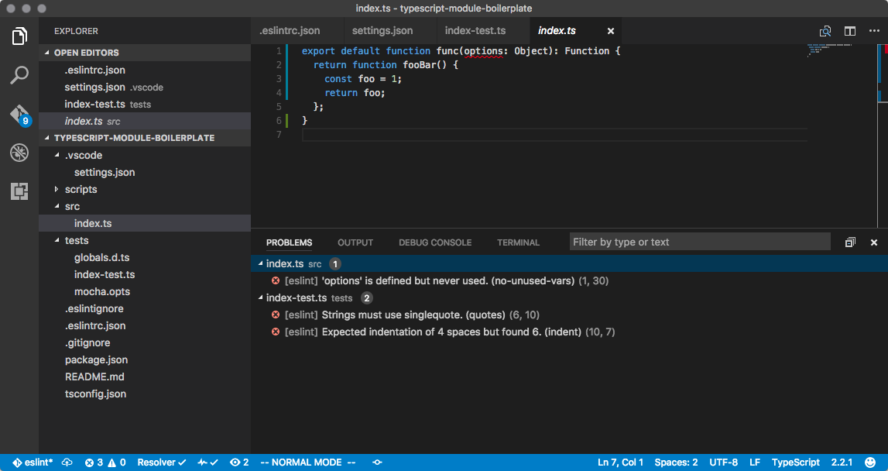

# typescript-module-boilerplate

Este es un módulo de plantilla para un proyecto que utiliza TypeScript como su lenguaje principal. Para usar esta plantilla, clónela, elimine la carpeta `.git` y comience el suyo. Quizás necesite eliminar algunos archivos adicionales según sea necesario.

## Descripción del Stack

* TypeScript
* Jest
* Prettier
* ESLint

## Uso

```bash
$ git clone https://github.com/alexgorbatchev/typescript-module-boilerplate.git
$ cd typescript-module-boilerplate
$ rm -fr .git
$ yarn
$ yarn test
```

## Características



* Linting mediante [ESLint](http://eslint.org/).
  * Ejecutar manualmente con `yarn lint`.
  * Se integra con Visual Studio Code mediante [vscode-eslint](https://github.com/Microsoft/vscode-eslint/).
    * Resalta problemas de tipo y de linting.
    * Proporciona opciones de depuración para ejecutar pruebas de Jest (una vez y en modo vigilancia).
  * Utiliza el [plugin ESLint de AirBNB](https://github.com/airbnb/javascript) como valores predeterminados recomendados.
  * Las declaraciones `import ... from ...` se verifican por su corrección mediante [eslint-plugin-import](https://github.com/benmosher/eslint-plugin-import).
* Formato mediante [Prettier](https://github.com/prettier/prettier).
  * Ejecutar manualmente con `yarn format`.
  * Se integra bien con Visual Studio Code mediante [prettier-vscode](https://github.com/prettier/prettier-vscode).
    * Formatea automáticamente al guardar.

## Comandos de Script

* `yarn test` -- Ejecuta las pruebas.
* `yarn typecheck` -- Verifica la corrección de los tipos de TypeScript. Esto se deshabilita durante las pruebas por razones de rendimiento.
* `yarn lint` -- Ejecuta el linting.
* `yarn format` -- Reorganiza el formato de todos los archivos `.ts` y `.tsx` con Prettier.
* `yarn build` -- Regenera la carpeta `dist` que se incluye en el módulo de NPM.

## Licencia

MIT
